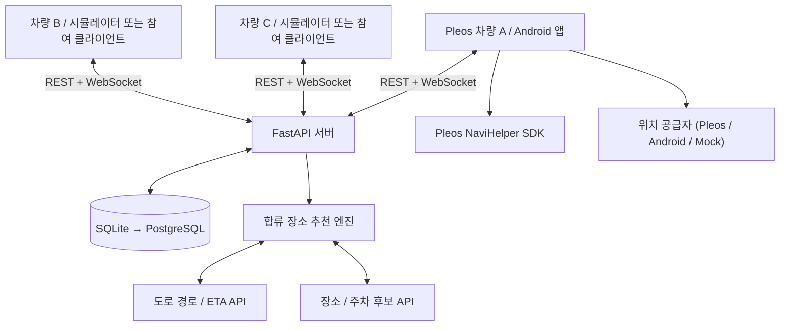

# Flock 설계 문서

> 개발 초기(2026-11-04)에 작성한 설계 문서입니다. 코드 주석의 `design.md §번호`는 이 문서의 절을 가리킵니다.
> 실제 구현과 실측 결과는 [api.md](api.md), [algorithm.md](algorithm.md), [architecture.md](architecture.md), [sdk-integration.md](sdk-integration.md)가 기준입니다.
> 앱의 화면 표시 이름은 Flock이고, 개발 당시 이름(MeetRoute)이 패키지 이름(`com.meetroute.app`)과 일부 문서에 남아 있습니다.
> 절 번호는 원래 문서 그대로이며, 내부 일정·역할·테스트 장소 계획 절(10~13, 16~18)은 뺐습니다.

## 1. 프로젝트 개요

### 1.1 해결하려는 문제

친구나 가족이 서로 다른 출발지에서 여러 대의 차량으로 같은 목적지에 이동할 때, 기존 내비게이션은 **각 차량의 최단 경로**에는 집중하지만 다음 문제를 함께 해결해 주지는 못합니다.

- 어디서 만나야 **모든 차량의 전체 이동 부담**이 최소인지 판단하기 어려움
- 특정 차량만 크게 우회하거나 먼저 도착해 오래 기다리는 문제
- 중간 합류 장소에 실제로 **안전하게 정차·주차할 수 있는지** 확인하기 어려움
- 합류 장소 변경 시 모든 차량이 다시 목적지·경유지를 입력해야 하는 불편
- 이동 도중 차량별 ETA가 달라져 합류 계획이 무너지는 상황

### 1.2 제안하는 해결책

**MeetRoute**는 참여 차량들의 현재 위치와 최종 목적지를 기반으로 합류 후보 장소를 계산한 뒤, 도로 기반 주행 시간·우회 비용·도착 시간 차이·주차 적합도를 고려하여 **상위 3개 합류 장소**를 추천합니다.

선택된 합류 장소는 참여 차량에 공유하며, Pleos 지원 차량에서는 **NaviHelper SDK로 내비게이션 경유지 등록을 요청**합니다.

### 1.3 핵심 가치

1. **개인별 최단 경로가 아닌 그룹 전체의 이동 효율**을 최적화
2. 운전자가 복잡한 계산 없이 **안전한 합류 장소**를 선택하도록 지원
3. Pleos Connect의 차량 위치·내비게이션과 연계한 **차량 특화 UX**
4. 향후 비-Pleos 차량도 스마트폰 보조 앱을 통해 그룹 참여가 가능한 확장 구조

### 1.4 대표 사용 시나리오

1. 차량 A, B, C가 각기 다른 위치에서 출발
2. 차량 A가 MeetRoute 그룹을 만들고 초대 코드 공유
3. B·C가 참여하고 위치 공유에 동의
4. 그룹장이 최종 목적지를 지정
5. 앱이 차량별 경로와 합류 가능한 장소를 분석
6. **추천 TOP 3**의 예상 합류 시각, 추가 주행 시간, 대기 시간, 정차 적합도를 표시
7. 그룹이 하나의 합류 장소를 선택
8. 선택 결과를 전 차량에 전달하고, Pleos 차량에서는 **NaviHelper 경유지 등록**
9. 주행 중 ETA를 업데이트하고 필요 시 재추천
10. 차량들이 합류하면 완료 처리 후 위치 공유 종료

## 2. 개발 목표와 범위

### 2.1 필수 구현 범위 (MVP)

- [x] **그룹 생성 / 참여 / 종료:** 초대 코드로 2~3대 차량 연결
- [x] **동의 기반 위치 공유:** 현재 위치, 갱신 시각, 온라인 여부
- [x] **공통 목적지:** 그룹장이 지정하고 모든 참여자에게 동기화
- [x] **도로 기반 ETA:** 차량→합류 후보→최종 목적지의 실제 도로 경로 시간 활용
- [x] **합류 후보 TOP 3:** 우회 시간, 총 이동 비용, 대기 시간, 장소 적합도 비교
- [x] **합류 장소 선택:** 모든 참여 차량에 실시간 동기화
- [ ] **내비게이션 연동:** Pleos NaviHelper SDK를 통한 경유지 등록 요청 및 결과 처리
- [x] **실시간 상태 화면:** 각 차량의 ETA, 연결 상태, 합류 진행 상태
- [x] **종료/철회:** 그룹 탈퇴 또는 위치 공유 동의 철회 시 즉시 갱신 중단
- [x] **빌드 및 시연:** Android APK, Python 서버, 다차량 시뮬레이터, 테스트 로그

### 2.2 선택 구현 범위 (필수 기능 이후)

- [ ] ETA 변동량에 따른 **자동 재추천** 및 사용자 승인 후 경유지 변경
- [ ] **음성 안내(TTS)** 및 운전 중 단순 알림
- [ ] **전기차 충전소 고려:** 배터리 정보 접근 권한 및 API 지원 시에만
- [ ] **컨보이(Convoy) 모드:** 합류 이후 그룹 주행 상태 표시
- [ ] **비-Pleos 차량 참여:** 일반 Android 스마트폰 보조 클라이언트
- [ ] 과거 경로 이력, 추천 결과 설명, 경로 비교 시각화

> 범위 원칙: **MVP를 완성하고 나서** 선택 기능을 추가합니다. SDK가 미지원·미승인 상태인 기능은 완료로 표시하지 않습니다.

### 2.3 제외할 기능

- 차량의 조향·가속·제동 등 직접 제어
- 주행 중 긴 텍스트 입력이나 복잡한 조작을 요구하는 화면
- 동의 없는 차량 추적, 그룹 외 사용자 위치 공개
- 검증되지 않은 실시간 교통·주차 가능 여부를 사실처럼 표시

## 3. 사용자 흐름 및 화면 설계

```text
[앱 실행]
    ↓
[그룹 만들기 / 참여하기]
    ↓
[위치 공유 동의 + 차량 별칭]
    ↓
[참여 차량 현황 / 공통 목적지 입력 / 만남 목적 선택]
    ↓
[차량별 현재 위치 및 ETA 확인]
    ↓
[합류 후보 분석]
    ↓
[추천 장소 TOP 3 비교]
    ↓
[합류 장소 선택 및 그룹 확정]
    ↓
[내비게이션 경유지 등록 요청]
    ↓
[실시간 ETA / 상태 갱신]
    ↓
[합류 완료 / 위치 공유 종료]
```

| 화면 | 필수 구성 요소 | 주요 동작 |
|---|---|---|
| 홈 | 그룹 만들기/참여 버튼 | 그룹 생성, 초대 코드 입력 |
| 그룹 대기실 | 참여 차량, 상태, 코드, 만남 목적 | 위치 동의, 목적지 설정, 만남 목적 선택(같이 출발 / 휴식 / 식사 / 상관없음) |
| 합류 추천 | 추천 TOP 3, 합류 예상 시각, 우회·대기 시간, 동행 주행 시간 | 후보 비교 및 선택, 목적지 직행이 더 나으면 안내 문구 표시 |
| 주행 현황 | 차량별 ETA, 상태, 합류 장소 | 내비 연동, 재추천 확인 |
| 합류 완료 | 결과 요약, 종료 버튼 | 공유 중단 및 세션 종료 |

**차량 화면 UX 원칙**

- 운전 중에는 큰 버튼·짧은 문구·최소 터치 횟수 사용
- 상세 비교나 긴 설정은 **정차 상태에서만** 제공하는 방식을 우선 검토
- 내비게이션을 대체하지 않고 **Pleos 기본 내비게이션과 연동**
- 추천 이유를 "총 우회 12분 / 최대 대기 4분"처럼 짧게 설명
- 위치 권한 거부, 서비스 미지원, 네트워크 단절 상태를 명확히 표시

## 4. 기술 스택

| 구분 | 기술 | 목적 |
|---|---|---|
| 차량용 앱 | **Kotlin + Android Automotive / Pleos Connect** | 앱 로직, 차량 화면 |
| UI | **Jetpack Compose** (Pleos 호환성 확인) | 화면 구성 및 상태 관리 |
| Android 개발 | **Android Studio**, **VS Code** | SDK/Gradle 관리, 코드 작성 |
| Android 빌드 | **Gradle Wrapper** | APK 빌드 및 의존성 관리 |
| 서버 | **Python + FastAPI** | 그룹 관리, 후보 추천, REST API |
| 실시간 통신 | **WebSocket** | 차량 위치·ETA·합류 장소 변경 전파 |
| DB | **SQLite** (MVP) → **PostgreSQL** (사용자 테스트·배포 단계) | 그룹, 참가자, 세션 및 설정 데이터. MVP 기간에는 설치·운영 부담을 줄이기 위해 SQLite로 시작 |
| 데이터 접근 | SQLAlchemy (+ Alembic은 PostgreSQL 전환 시) | ORM. SQLAlchemy를 쓰면 DB 전환 시 코드 변경이 적음 |
| 경로 계산 | **외부 도로 경로/ETA API** (공급자 선정 필요) | 경로 기반 주행시간 및 거리. **다중 출발지·목적지(매트릭스) 조회 지원 여부**를 선정 기준 1순위로 둠 |
| 후보 장소 | **고속도로 휴게소 공공데이터** (MVP) + 지도/장소 검색 API (확장) | MVP는 위치·노선·**진행 방향**·편의시설·충전소 정보가 있는 휴게소로 한정. 공영주차장 등은 확장 단계 |
| Pleos 위치 | **FusedLocation SDK** (제공/접근 가능 여부 확인), 대체: NaviHelper `getCurrentLocationInfo` | 차량 위치 수집 |
| Pleos 내비 | **NaviHelper SDK** | 목적지·경유지 요청, 이벤트 수신 |
| 테스트 | pytest, Kotlin 단위 테스트, Mock/시뮬레이터 | 알고리즘 및 앱 로직 검증 |
| 협업 | Git + GitHub | 버전 관리, 제출 산출물 |

**Pleos 공식 개발 환경 참고:** 개발 환경 요구사항 문서 기준 최소 Android API 26 이상, Gradle `>= 8.0`, 개발 언어 Java/Kotlin. 이 프로젝트는 `minSdk 28`, `targetSdk/compileSdk 34`로 시작합니다(최소 요구사항을 만족). 실제 빌드에서는 설치한 Android Gradle Plugin과 SDK 조합에 맞춰 버전을 확정합니다.

> [!WARNING]
> **FusedLocation SDK 상태가 문서마다 다르게 표시됩니다.** 개발 환경 요구사항 페이지에는 FusedLocation SDK v1.0.4가 버전 목록에 올라 있지만, SDK 소개 페이지와 Playground 프로젝트 안내 페이지에는 "준비 중"/`Not Available Yet` 표시가 남아 있는 경우가 있습니다. 따라서 **Phase 0에서 실제 의존성 추가와 Gradle Sync가 되는지 직접 확인**합니다.
>
> FusedLocation을 쓸 수 없으면 **NaviHelper SDK의 `getCurrentLocationInfo`로 차량 위치를 받는 경로**를 우선 대체 수단으로 씁니다. 이 경우에도 Pleos SDK로 차량 위치를 받는 것이므로 심사에서 설명하기 좋습니다. Android 위치 API나 시뮬레이터는 개발·테스트용이며, 이것을 **FusedLocation SDK 연동 성공으로 간주하지 않습니다.**

## 5. 전체 시스템 아키텍처



### 5.1 핵심 원칙: 비즈니스 로직과 차량 SDK 분리

차량 위치와 내비게이션 기능을 **교체 가능한 어댑터**로 설계합니다. 이는 "Mock 앱만 개발"하려는 목적이 아니라 **실제 앱을 먼저 구현한 후 Pleos 환경에서 SDK 연동을 검증**하기 위한 전략입니다.

```text
VehicleLocationSource
 ├─ PleosFusedLocationSource     # SDK 접근 시 실제 연동 (1순위)
 ├─ PleosNaviLocationSource      # NaviHelper getCurrentLocationInfo 기반 (FusedLocation 미제공 시 2순위)
 ├─ AndroidLocationSource        # 일반 Android 환경 검증
 └─ SimulatedLocationSource      # 시나리오 기반 자동 테스트

NavigationGateway
 ├─ PleosNaviHelperGateway      # 실제 목적지/경유지 설정 및 콜백
 └─ RecordingNavigationGateway # 테스트 요청/응답 기록

MeetPointRepository
 ├─ RoadRoutingMeetPointRepository # 실제 경로 API + 휴게소 공공데이터
 └─ FixtureMeetPointRepository     # 고정된 검증 데이터 (오프라인 시연 모드에도 사용)
```

**완료 기준:** Pleos 어댑터를 제외한 모든 기능은 로컬에서 실제 API·서버·데이터 흐름으로 검증합니다. Pleos 어댑터는 가능하면 미리 **실제 SDK에 대한 컴파일 및 권한 선언**까지 진행하고, GPU PC의 Pleos 에뮬레이터에서 런타임 검증을 수행합니다.

## 6. 저장소 폴더 구조 (목표)

> 아래는 **만들어 갈 구조**입니다. 현재 이 폴더와 파일이 모두 존재한다는 뜻이 아닙니다.

```text
MeetRoute/
├── README.md
├── .gitignore
├── .env.example
├── android-app/
│   ├── app/
│   │   └── src/main/
│   │       ├── AndroidManifest.xml
│   │       └── java/com/meetroute/app/
│   │           ├── ui/                 # Compose 화면/컴포넌트
│   │           ├── domain/             # 비즈니스 규칙과 모델
│   │           ├── data/               # REST / WebSocket / 저장소
│   │           ├── location/           # 위치 공급자 인터페이스/구현
│   │           ├── navigation/         # NaviHelper 연동
│   │           └── di/                 # 의존성 주입 및 구성
│   ├── build.gradle.kts
│   ├── settings.gradle.kts
│   └── gradlew.bat
├── backend/
│   ├── app/
│   │   ├── main.py                     # FastAPI 진입점
│   │   ├── api/                        # REST 엔드포인트
│   │   ├── ws/                         # 실시간 채널
│   │   ├── models/                     # DB/데이터 스키마
│   │   ├── services/                   # 그룹·세션·ETA
│   │   ├── optimization/               # 합류 후보 분석 및 점수 계산
│   │   └── integrations/               # 경로·장소 외부 API
│   ├── tests/
│   ├── requirements.txt
│   └── .env.example
├── simulator/
│   ├── vehicle_simulator.py            # 가상 차량 다중 업데이트
│   ├── scenarios/                      # 출발점·목적지 테스트셋
│   └── README.md
├── data/
│   └── rest_areas.csv                  # 고속도로 휴게소 공공데이터 (위치·노선·방향·편의시설)
├── tests/
│   └── e2e/                            # 전체 흐름 테스트
├── docs/
│   ├── api.md
│   ├── architecture.md
│   ├── algorithm.md
│   ├── ui-flow.md
│   ├── sdk-integration.md
│   ├── experiments.md
└── apk/                                 # 제출용 APK만 별도 보관
```

## 7. 서버/API 설계 (초안)

API 요청/응답의 정확한 필드는 구현 과정에서 OpenAPI 문서로 고정합니다.

### 7.1 REST API

| 메서드 | 경로 | 설명 |
|---|---|---|
| `POST` | `/api/v1/groups` | 그룹 생성 및 초대 코드 발급 |
| `POST` | `/api/v1/groups/join` | 초대 코드로 참여 |
| `GET` | `/api/v1/groups/{group_id}` | 그룹·참여자·목적지 조회 |
| `PATCH` | `/api/v1/groups/{group_id}/destination` | 공통 목적지 변경 |
| `PATCH` | `/api/v1/groups/{group_id}/meeting-purpose` | 만남 목적 변경 (`DEPART_TOGETHER` / `REST` / `MEAL` / `ANY`) |
| `POST` | `/api/v1/groups/{group_id}/locations` | 차량 위치 갱신 (개발/백업 경로) |
| `POST` | `/api/v1/groups/{group_id}/recommendations` | 후보 장소 계산 요청 |
| `GET` | `/api/v1/groups/{group_id}/recommendations` | TOP 3 결과 조회 |
| `POST` | `/api/v1/groups/{group_id}/meeting-point` | 합류 장소 확정 |
| `POST` | `/api/v1/groups/{group_id}/leave` | 그룹 탈퇴 및 공유 해제 |
| `POST` | `/api/v1/groups/{group_id}/complete` | 합류 완료, 세션 종료 |
| `GET` | `/health` | 서버 생존 확인 |

### 7.2 WebSocket

- 경로 예시: `/ws/groups/{group_id}`
- 인증: 그룹 참여 권한을 확인할 수 있는 **만료형 토큰** 사용
- 클라이언트 → 서버: `location.updated`, `eta.requested`, `presence.heartbeat`
- 서버 → 클라이언트: `participant.updated`, `recommendations.ready`, `meeting_point.selected`, `session.closed`, `error`
- 이벤트 공통 필드: `type`, `group_id`, `timestamp`, `payload`, `event_id`
- 중복 전송/재접속을 고려하여 **최신 상태 재동기화 API** 제공

### 7.3 기본 데이터 모델

```json
{
  "group_id": "demo-group-001",
  "destination": {
    "lat": 37.5,
    "lon": 127.0,
    "name": "최종 목적지"
  },
  "meeting_purpose": "REST",
  "participants": [
    {
      "vehicle_id": "car-a",
      "lat": 37.55,
      "lon": 126.95,
      "timestamp": "2026-11-04T06:00:00Z",
      "location_sharing": true,
      "status": "ACTIVE"
    }
  ],
  "selected_meeting_point_id": null
}
```

*위 좌표와 ID는 형식을 설명하기 위한 예시 데이터입니다.*

### 7.4 동기화 규칙

- 주행 중 위치 갱신: **약 5~10초 주기**를 시작점으로 설정 (실제 환경에 맞춰 조정)
- 마지막 위치가 **20초 이상** 갱신되지 않으면 `STALE` 표시
- 권한 철회/그룹 탈퇴 시 서버의 실시간 공유를 즉시 중단
- 특정 차량이 끊겨도 남은 참가자 화면이 멈추지 않도록 설계
- 위치는 반드시 `timestamp`와 함께 저장하여 **서로 다른 측정 시각의 ETA를 그대로 비교하지 않음**
- 실제 프로덕션에서는 HTTPS/WSS, 권한 확인, 요청 제한, 로그 민감정보 마스킹 적용

## 8. 합류 지점 추천 알고리즘

### 8.1 입력

- 그룹 차량 집합 `V = {v1, v2, ..., vn}` (MVP: 2~3대)
- 차량별 현재 위치, 마지막 측정 시각, 현재 ETA
- 모든 차량의 공통 최종 목적지 `D`
- 경로 주변의 **정차/주차 가능한 후보 장소** 집합 `P`
- 차량→합류 후보→목적지에 대한 **실제 도로 경로 기반 시간·거리**
- 그룹이 선택한 **만남 목적** (`DEPART_TOGETHER` / `REST` / `MEAL` / `ANY`)

### 8.2 후보 생성 및 필터링

MVP에서는 후보를 **고속도로 휴게소**로 한정합니다. 휴게소는 안전한 정차·주차 공간이 확보되어 있고, 공공데이터에 위치·노선·방향·편의시설·충전소 정보가 있어 필터링이 쉽습니다. 실제 제공 항목은 데이터를 내려받아 확인한 뒤 확정합니다. 공영주차장·대형 주차장은 확장 단계에서 추가합니다.

1. 차량별 `현재 위치 → 최종 목적지` 기본 경로 조회 → `T_base(i)`와 경로 형상(polyline) 확보
2. 휴게소 목록에서 **하나 이상의 차량 경로로부터 2km 이내**(초기값)인 휴게소 수집
3. **진행 방향 필터:** 고속도로 휴게소는 상행·하행이 분리되어 있으므로, 각 차량의 진행 방향과 같은 방향의 휴게소만 남김. 반대 방향 휴게소는 접근 불가로 처리
4. 졸음쉼터 등 단시간 정차용 시설, 영업시간·주차 여부가 불명확한 후보는 제외 또는 강한 감점
5. 직선거리 기반 간이 점수로 **상위 K개(초기값 10~20개)**만 남긴 뒤 상세 경로 ETA 계산
6. **목적지 `D` 자체를 항상 비교 후보에 포함** (8.3의 "목적지 비교 후보" 참고)

> 단순한 지리적 중간점(위도·경도 평균)은 **기준선 비교용**이지 최종 추천 알고리즘이 아닙니다.

### 8.3 점수 계산

각 차량 `i`의 후보 `p` 경유 총 주행 시간과 기본 주행 시간을 비교합니다.

- `T_base(i)`: 현재 위치에서 최종 목적지까지 바로 가는 예상 주행 시간
- `T_to(i,p)`: 현재 위치에서 후보 `p`까지 가는 예상 주행 시간
- `T_after(p)`: 후보 `p`에서 최종 목적지까지 가는 예상 주행 시간 (합류 후 함께 이동하므로 모든 차량에 공통)
- `T_via(i,p) = T_to(i,p) + T_after(p)`
- `detour(i,p) = max(0, T_via(i,p) - T_base(i))`
- `arrival(i,p)`: **현재 시각 기준 절대 시각**으로 환산한 후보 도착 예상 시각
- `meet_time(p) = max_j arrival(j,p)`: 마지막 차량이 도착하는 시각 = 합류 완료 시각
- `wait(i,p) = meet_time(p) - arrival(i,p)`
- `shared(p) = T_after(p)`: 합류 후 함께 주행하는 시간 (**동행 주행 시간**)
- `safety_penalty(p)`: 주차/진입 가능성 등 부적합도를 0~1로 환산 (검증 수준 반영)

**왜 `shared(p)`가 필요한가**

우회·대기·장소 적합도만으로 점수를 매기면 **"언제 만나느냐"에 대한 선호가 식에 없습니다.** 모든 차량이 같은 고속도로에 진입한 이후의 휴게소는 모든 차량 경로 위에 있어 `detour ≈ 0`이고, 도착 시간 차이도 거의 유지되어 `wait`도 비슷합니다. 그래서 출발 직후 휴게소와 목적지 직전 휴게소가 사실상 동점이 됩니다. 목적지 `D`를 후보에 넣으면 `detour = 0`이 되어 "목적지에서 만나라"가 최적으로 계산될 수도 있습니다. 이를 막기 위해 동행 주행 보상과 합류 시간대 제약을 함께 씁니다.

후보 점수:

```text
score(p) = α × norm(Σ detour(i,p))
         + β × norm(Σ wait(i,p))
         + γ × norm(max_i detour(i,p))
         + δ × norm(safety_penalty(p))
         − ε × norm(shared(p))
```

**작을수록 좋은 점수**입니다.

**정규화:** 항목마다 단위와 규모가 다르므로, 한 번의 추천에서 후보 집합 전체를 기준으로 0~1 범위로 정규화합니다.

```text
norm(x(p)) = (x(p) − min_p x) / (max_p x − min_p x)
```

후보 간 차이가 3분 미만(초기값)이면 해당 항목은 모든 후보에서 0으로 처리합니다. 정규화로 사라지는 절대 크기 정보는 필터(아래 `detour_max`)로 보완합니다.

**초기 가중치 (실험용, 민감도 분석으로 조정)**

| 가중치 | 값 | 항목 | 비고 |
|---|---|---|---|
| α | 1.0 | 총 추가 주행 시간 | |
| β | 0.7 | 전체 대기 시간 | 휴게소에서 쉬며 기다리는 시간은 운전보다 부담이 작다고 가정 |
| γ | 0.5 | 최대 개인 우회 | `Σ detour`와 일부 겹치므로 "공평성 보정"으로 해석 |
| δ | 0.3 | 장소 부적합도 | |
| ε | 0.6 | 동행 주행 보상 | |

가중치는 정규화된 항목 사이의 상대적 교환 비율이며, 전체 점수에서 차지하는 비중(%)을 뜻하지 않습니다.

**참고:** `detour(i,p) + wait(i,p) = meet_time(p) + T_after(p) − T_base(i)`(detour가 0으로 보정되지 않는 경우)입니다. 즉 차량 `i`가 합류하지 않았을 때보다 목적지에 늦게 도착하는 시간과 같습니다. α = β로 두면 그룹 전체의 목적지 도착 지연 합을 최소화하는 것과 같아지고, β < α는 대기를 운전보다 덜 나쁘게 보는 설계 선택입니다.

**필터 (점수와 무관하게 제외)**

- 개인 추가 주행 시간 `detour(i,p)`가 `detour_max`(초기값 20분)를 넘는 후보
- 합류 완료 시각 `meet_time(p)`가 만남 목적별 허용 범위를 벗어나는 후보 (목적지 `D`는 예외)
- 그룹의 일부 차량만 접근 가능한 후보

**만남 목적별 합류 시간대 (초기값)**

| 만남 목적 | `meet_time(p)` 허용 범위 | 비고 |
|---|---|---|
| `DEPART_TOGETHER` 같이 출발 | 현재 시점 기준 60분 이내 | ε를 높여 이른 합류 우선 |
| `REST` 휴식 | 출발 후 90~150분 | 장거리 운전 휴식 권고 주기 반영 (팀원이 근거 조사 후 확정) |
| `MEAL` 식사 | 지정한 식사 시각 ±30분 | 식당이 있는 휴게소만 허용 |
| `ANY` 상관없음 | 제약 없음 | 기본 가중치 사용 |

허용 범위 안에 후보가 없으면 범위를 넓혀 다시 탐색하고, 그래도 없으면 목적지 합류를 추천합니다.

**목적지 비교 후보:** 목적지 `D`는 시간대 제약과 관계없이 항상 후보에 포함합니다. `D`가 1위로 계산되면 "이번 경로는 중간 합류의 이득이 작아 목적지에서 만나는 것을 추천합니다"라고 안내합니다. 무리한 중간 합류를 권하지 않는 것도 추천 품질의 일부로 봅니다.

### 8.4 반환 결과

각 추천 후보에는 최소한 다음 정보가 있어야 합니다.

```text
place_id / name / latitude / longitude / direction
estimated_group_meeting_time      # meet_time(p)
per_vehicle_arrival_eta
per_vehicle_detour_minutes
total_wait_minutes
max_detour_minutes
shared_driving_minutes            # shared(p)
parking_or_stop_suitability
is_destination_fallback           # 목적지 직행 후보 여부
score / reason
```

### 8.5 품질 및 비용 최적화

- 먼저 저비용 후보 필터링 → 최종 후보에만 고비용 경로 API 조회
- **1회 추천의 경로 조회 수 = `n + n·K + K`** (차량 3대, 후보 20개 기준 약 83회). 매트릭스 API로 묶어 호출하고, 응답 5초를 넘으면 K를 줄임
- `T_after(p)`는 목적지가 바뀌지 않는 한 세션 동안 캐시
- 차량 위치 변화가 미미할 때 이전 `T_to(i,p)` 재사용
- 한 번의 추천에 쓰는 경로 시간은 **같은 시점에 조회한 값**으로 통일
- API 요청 횟수·요금·쿼터를 추적
- 경로 API 오류 시 **근거 없는 ETA를 생성하지 않음**; 마지막 정상 데이터와 갱신 시각 표시
- 무조건 재추천하지 않고 ETA 변화 임계값을 둬서 과도한 경로 변경 방지

### 8.6 알고리즘 평가 기준

기준선(Baseline)을 별도로 구현하여 비교합니다.

- **B0:** 목적지 직행 (중간 합류 없음) — 합류 자체의 이득을 보여 주는 기준
- **B1:** 출발 위치의 단순 지리적 중간점에 가장 가까운 적합 POI
- **B2:** 대표 차량의 경로만 고려한 합류 장소
- **B3:** `shared(p)` 항과 시간대 제약을 뺀 버전 — 합류 이득 항이 결과를 실제로 바꾸는지 확인
- **Ours:** 모든 차량의 우회·대기·장소 적합도·동행 주행 시간을 함께 고려한 추천

평가 지표:

1. 총 추가 주행 시간 (`Σ detour`)
2. 그룹 전체 대기 시간 (`Σ wait`)
3. 가장 불리한 차량의 추가 주행 시간 (`max detour`)
4. 최종 합류까지의 시간 / 후보 실패율
5. 추천 계산 시간 및 경로 API 호출 수

**테스트 시나리오 최소 10~20개**를 준비하고, 차량 수·거리·교통 상황·후보 밀도에 따라 결과를 비교합니다. 각 비교는 동일한 시점·동일한 경로 API 조건에서 수행합니다.

## 9. Pleos Connect SDK 연동 계획

### 9.1 FusedLocation SDK

목표 동작:

1. 환경 지원 여부 확인 (`isSupported` 등 실제 버전별 API 확인)
2. 위치 공유 동의 및 필요한 권한 확인
3. SDK 초기화 → 마지막 위치/위치 갱신 수신
4. 서버에 차량 위치 송신
5. 화면 종료·동의 철회·그룹 종료 시 콜백 제거 및 자원 해제

**Pleos 내 대체 경로:** FusedLocation을 쓸 수 없으면 NaviHelper SDK의 `getCurrentLocationInfo`로 차량 위치를 받습니다(`PleosNaviLocationSource`). 갱신 주기와 정확도는 Pleos 에뮬레이터에서 확인합니다.

**대체 테스트:** 같은 도메인 모델을 사용하는 Android 위치 공급자/시뮬레이터로 로컬 통합 테스트. 실제 FusedLocation 기능과 동일하다고 주장하지 않습니다.

### 9.2 NaviHelper SDK

목표 동작:

1. SDK 의존성과 권한 선언
2. `initialize()` 실행
3. 이벤트 리스너 등록 (`addListener()`)
4. 선택한 합류 장소를 **경유지 또는 목적지로 설정** 요청
5. 성공·실패 및 경로 재탐색 결과 콜백 반영
6. `removeListener()` 및 `release()` 호출

NaviHelper 요청의 **완료를 성공으로 가정하지 않고**, 실제 콜백을 받아 화면 상태를 업데이트합니다.

**추가 확인:** `getRouteStateInfo`가 남은 시간·남은 거리를 반환하는지 확인합니다. 반환한다면 주행 현황 화면의 ETA를 외부 경로 API 대신 **차량 내비게이션의 실제 ETA**로 표시합니다. 차량 특화성이 높아지고 외부 API 호출도 줄어듭니다.

### 9.3 SDK 연동 확인 체크리스트

- [ ] Pleos Playground 프로젝트 등록 및 SDK 접근 가능 여부 확인
- [x] 필요한 AAR/Maven 의존성 확보 및 Gradle Sync 성공
- [x] Android Manifest 권한 및 차량 앱 관련 요구사항 확인
- [ ] FusedLocation 사용 가능 여부 확인 / 대체 경로(NaviHelper `getCurrentLocationInfo`) 동작 확인
- [x] NaviHelper `getRouteStateInfo`가 남은 시간·거리를 반환하는지 확인
- [x] NaviHelper 진입점 초기화·이벤트 등록·정리 코드 작성
- [x] 일반 노트북에서 가능한 범위의 **컴파일 및 단위 테스트** 통과
- [ ] Pleos 에뮬레이터에서 초기화/권한 동작 확인
- [ ] Pleos 에뮬레이터에서 경유지 설정 요청과 실제 반영 확인
- [ ] 기능 미지원·실패·네트워크 끊김 상황 처리

**공식 문서**

- [Pleos Playground](https://developers.pleos.ai/playground)
- [Pleos Connect 앱 개발 시작](https://document.pleos.ai/en/docs/pleos-only/getting-started)
- [개발 환경 요구사항 (SDK 버전·최소 API·Cold Boot)](https://pleos.ai/playground/resources/docs/guide/getting-started/application-development/setup-application-development-environment)
- [Pleos Connect SDK 개요](https://document.pleos.ai/en/docs/pleos-only/connect-sdk-pleos/)
- [FusedLocation 소개](https://document.pleos.ai/en/docs/pleos-only/connect-sdk-pleos/FusedLocation/intro)
- [NaviHelper 소개](https://document.pleos.ai/en/docs/pleos-only/connect-sdk-pleos/NaviHelper/intro)
- [에뮬레이터 설치](https://document.pleos.ai/en/docs/connect/guide/getting-started/application-development/setup-connect-sdk-emulator)
- [에뮬레이터 하드웨어 사양](https://document.pleos.ai/en/docs/connect/guide/getting-started/application-development/configure-pleos-connect-emulator)

## 14. 테스트 계획 및 완료 기준

### 14.1 자동화 테스트

- **Backend unit:** 점수 계산, 정규화(후보 간 차이가 없을 때 0 처리), ETA 시간대/측정 시각, 가중치, 빈 후보, API 오류
- **Algorithm sanity:** 반대 방향 휴게소가 제외되는지, 목적지 후보가 1위일 때 안내가 나오는지, 만남 목적별 시간대 필터가 동작하는지, 모든 후보가 동점이 되지 않는지
- **Backend integration:** 그룹 생성·참여·위치 전송·추천·종료
- **WebSocket:** 동시 접속, 순서 변경, 재접속, 만료 토큰, 참가자 이탈
- **Android unit:** 화면 상태/도메인 로직, SDK 어댑터의 실패 처리
- **E2E:** 3대 동시 진입 → 목적지 → TOP 3 → 경유지 선택 → 상태 갱신 → 종료
- **Performance:** 차량 2~3대 및 후보 수 증가 시 추천 지연·외부 API 요청 수

### 14.2 필수 실패 케이스

- [ ] 위치 권한 거부 또는 지원하지 않는 환경
- [x] 위치값 `null`, 부정확한 좌표, 오래된 타임스탬프
- [ ] 통신 끊김 및 재연결
- [x] 초대 코드 만료·잘못된 입력·권한 없는 참여
- [x] 그룹 내 1대 탈퇴 또는 공유 철회
- [x] 경로 API 제한/오류·후보 장소 0개
- [x] 만남 목적 시간대 안에 후보 0개 → 범위 확장 → 그래도 없으면 목적지 합류 추천
- [x] 추천 장소 선택 동시 요청 충돌
- [x] NaviHelper 초기화 실패·경유지 등록 실패
- [ ] 앱 백그라운드/종료 시 위치 공유 정리

### 14.3 MVP 완료(Definition of Done)

- [x] 차량 3대가 **하나의 그룹**으로 연결되는 흐름을 재현할 수 있음
- [x] 차량 위치와 ETA가 실시간으로 동기화됨
- [x] 안전하게 정차 가능한 후보 TOP 3에 대한 **설명 가능한 추천 이유** 제공
- [x] 선택된 합류 장소가 모든 참가자에게 전달됨
- [x] Android 앱이 빌드되며 정상 동작함
- [x] 서버와 시뮬레이터의 자동화 테스트 통과
- [ ] Pleos SDK를 이용한 경유지 등록 기능이 **실행 환경에서 검증됨** (공모전 최종 시연 목표)
- [ ] 오류/권한 거부/연결 종료가 정상적으로 처리됨
- [ ] README와 데모 영상만으로 제3자가 재현 가능

## 15. 보안·개인정보·차량 안전

- 위치 공유는 **명시적 동의 후에만** 시작하며 앱에서 항상 공유 상태를 표시
- 그룹별 짧은 초대 코드는 **인증 수단이 아닌 초대 수단**으로 취급하고 별도 토큰 검증
- 위치·토큰·API 키는 로그, APK 하드코딩, 공개 GitHub에 포함하지 않음
- 서버 통신은 배포 시 HTTPS/WSS 사용
- 그룹 종료 후 위치 갱신 중단; 데이터 보존·삭제 정책을 명시
- 주차 가능 여부는 장소 데이터 출처 및 실제 확인 가능 범위를 구분
- 운전 중 과도한 입력 유도 금지, 재탐색/경유지 변경은 적절한 사용자 확인 절차 적용
- 공용 PC 테스트 후 계정·개인키·토큰·임시 파일 정리

## 19. 참고 문서

- [공모전 공식 홈페이지](https://appdevchallenge.auto-hmg.io/)
- [Pleos Playground](https://developers.pleos.ai/playground)
- [Pleos Connect 개발자 문서](https://document.pleos.ai/)
- [Pleos Connect 앱 개발 시작](https://document.pleos.ai/en/docs/pleos-only/getting-started)
- [Pleos Connect 에뮬레이터 설치](https://document.pleos.ai/en/docs/connect/guide/getting-started/application-development/setup-connect-sdk-emulator)
- [Android Studio 공식 다운로드](https://developer.android.com/studio)
- [FastAPI 공식 문서](https://fastapi.tiangolo.com/)

---

**MeetRoute — 함께 가는 길, 더 합리적인 만남.**

